# 🤖 나만의 AI 비서 — 창원 소상공인 데이터 분석 · 콘텐츠 기획 비서

경남 **창원** 소상공인이 "지금 우리 업종 분위기가 어때? 뭘 홍보하면 좋을까?"를 **데이터로 확인하고 바로 실행**할 수 있게 돕는 AI 비서 웹 서비스입니다.

- 네이버 데이터랩 **검색 관심도**(카페 · 미용/뷰티 · 미용의료)와 KOSIS **창원시 인구**를 요약하고
- 그 요약을 **GPT에 주입**해 "왜 그런지"를 대화로 설명하며
- 업종·계절·내 상품을 입력하면 **SNS 콘텐츠 기획안 + 롱테일 키워드 + 리뷰 확보 아이디어**까지 만들어 줍니다.

> AI 응용 학습 **M1-2** 개인 과제 — "AI Agent 개발: 나만의 AI 비서"

### ✅ 과제 수행 범위

| 구분 | 수행 여부 |
|---|---|
| 필수 과제 (FastAPI · Firestore · GPT · 배포 · 바닐라 프론트 · README) | ✅ 완료 |
| **보너스 A** — 도구 호출(Function Calling) + 멀티채널(**MCP Server**) | ✅ **수행** |
| **보너스 B** — 추가 지표 + 그래프 + 내보내기 + 다크 모드 | ✅ **수행** |

---

## 🔗 배포 주소

| 구분 | 주소 |
|---|---|
| 프론트엔드 (Vercel) | https://ai-secretary-omega-eight.vercel.app |
| 백엔드 API (Render) | https://ai-secretary-07fk.onrender.com |
| API 문서 (Swagger) | https://ai-secretary-07fk.onrender.com/docs |

> ⏱️ **콜드스타트 안내** — 백엔드는 Render 무료 요금제라 15분 이상 쓰지 않으면 잠듭니다.
> 처음 접속하면 깨어나는 데 **30초~1분** 걸릴 수 있어요(정상). 두 번째부터는 빠릅니다.

---

## 📊 데이터

| 구분 | 내용 |
|---|---|
| 검색 관심도(시계열) | 네이버 데이터랩 "검색어 트렌드" — 창원 3업종(**카페 · 미용/뷰티 · 미용의료**), 상대지수(0~100, 최고=100), 2025-09-09 ~ 2026-09-09, 업종별 366일 · **총 1,098행** |
| 인구(보강 데이터) | KOSIS 국가통계포털 OpenAPI(원자료: 행정안전부 주민등록인구통계) — 창원시(코드 48120) 총인구수, 월별 최근 60개월 |
| 저장소 | Firebase Firestore — `data`(검색 관심도), `population`(인구), `conversations`(대화 기록) |
| 데이터 구조 | `date`(날짜) / `value`(지수) / `memo`(업종) |

> 검색 관심도는 **상대지수**(절대 검색량이 아님)이고 인구는 **명** 단위라 컬렉션을 분리하고, GPT에는 두 요약을 따로 전달합니다.

---

## 🛠️ 기술 스택

| 영역 | 사용 기술 |
|---|---|
| 백엔드 | FastAPI (Python) |
| 프론트엔드 | HTML / CSS / JavaScript (바닐라, 프레임워크 없음) |
| 데이터베이스 | Firebase Firestore |
| AI | OpenAI 호환 GPT API (코디세이 게이트웨이, `gpt-5-mini`) |
| 외부 데이터 | 네이버 데이터랩 · KOSIS OpenAPI |
| 시각화 / 내보내기 | Chart.js · SheetJS |
| 배포 | 백엔드 **Render** · 프론트 **Vercel** (GitHub push 시 자동 배포) |
| 멀티채널 | **MCP (Model Context Protocol) Server** |

---

## ✨ 주요 기능

- **데이터 관리(CRUD)** — 추가 / 조회 / 수정 / 삭제
- **데이터 요약** — 업종별 기간·개수·평균·최고·최저·추세(`/api/data/summary`)
- **인구 연동** — KOSIS에서 월별 인구를 받아 저장·요약(`/api/population*`)
- **AI 대화** — 데이터 요약을 GPT 시스템 프롬프트에 주입해 답변, 대화는 자동 저장(`/api/chat`)
- **대화 기록** — 이전 대화 목록 / 불러오기(`/api/conversations`)
- **콘텐츠 추천** — 업종·계절·채널·**내 상품**을 넣으면 홍보 기획안 + 롱테일 키워드 6개 + 리뷰 확보 아이디어 3개(`/api/content-plan`)
- **쉬운 대시보드** — 비서 브리핑 말풍선, 업종별 신호등(증가/유지/감소), 하단 5칸 메뉴(🏠홈 · 📊분석 · ✨콘텐츠 · 💬비서 · ⋯더보기)

---

## 🖼️ 제출 스크린샷

### 1. 배포 URL 접속 (프론트 / 백엔드 / Swagger)

| 백엔드 Swagger(`/docs`) | 백엔드 데이터 요약 실행 |
|---|---|
| 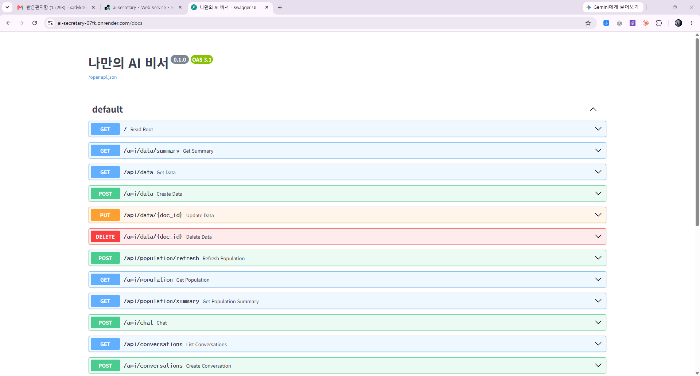 | 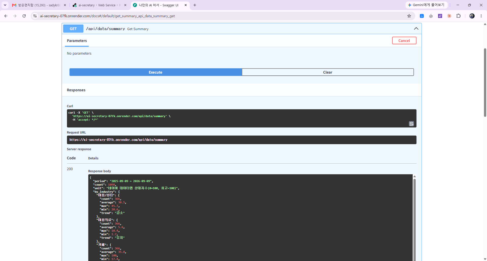 |

| Vercel 배포 성공 | 배포된 프론트 홈 |
|---|---|
| 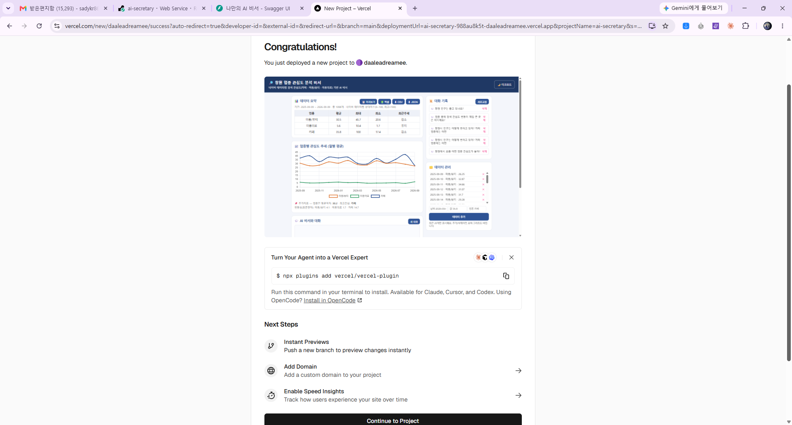 | 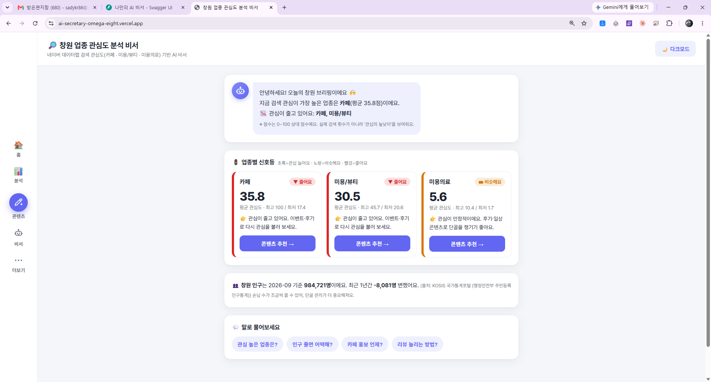 |

### 2. 데이터 요약이 보이는 채팅 화면 (질문 + 답변)

데이터 요약이 GPT에 주입된 상태에서 질문하면, 요약 수치를 근거로 답합니다.

| 질문 전 | 로딩 표시("생각 중…") |
|---|---|
| 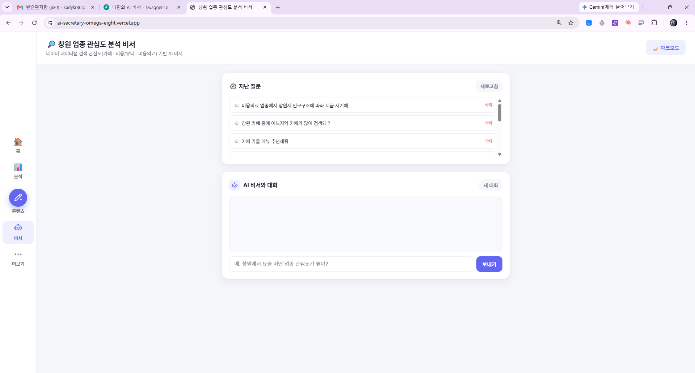 | 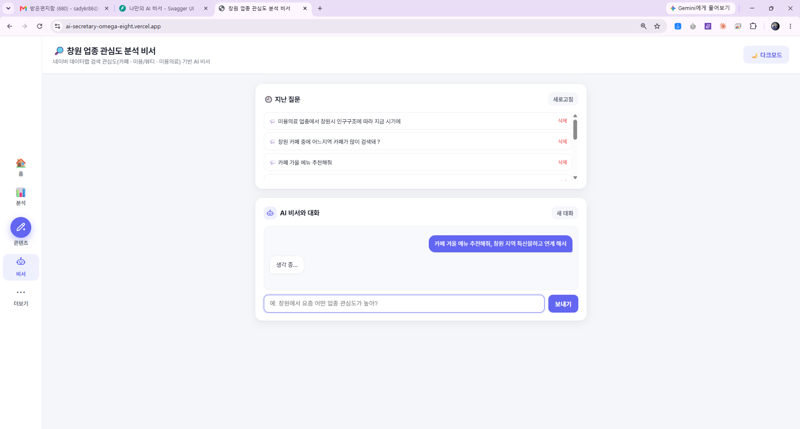 |

| 질문 + 답변 | 답변 이어서 |
|---|---|
| 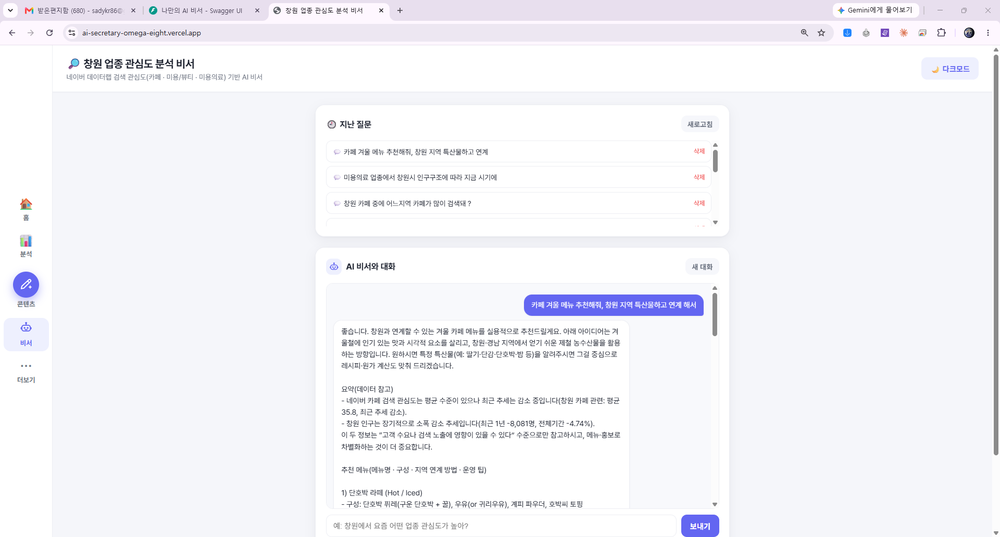 | 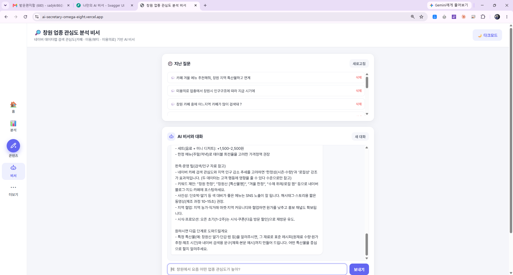 |

### 3. 데이터 관리 화면 (삭제 동작 확인)

삭제 전에는 맨 위 날짜가 `2025-09-10`, 삭제 후에는 `2025-09-12`로 바뀌어 행이 지워진 것을 확인할 수 있습니다.

| 삭제 전 | 삭제 후 |
|---|---|
| 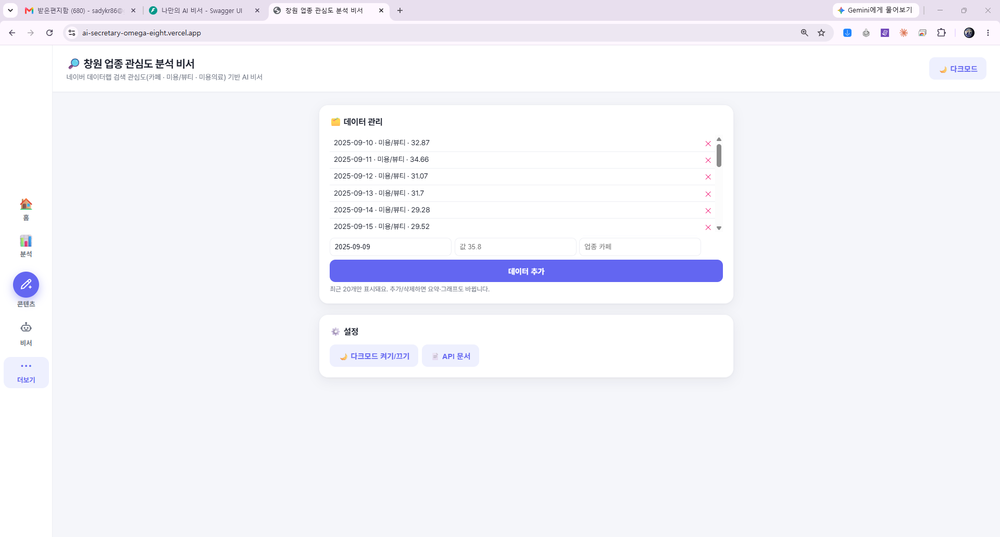 | 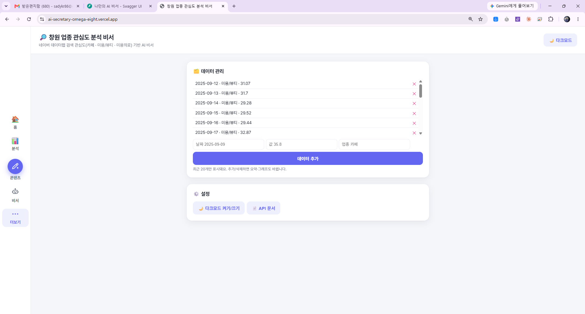 |

### 4. 대화 기록 화면 (불러오기 동작)

| 지난 대화 선택 | 불러온 결과 |
|---|---|
| 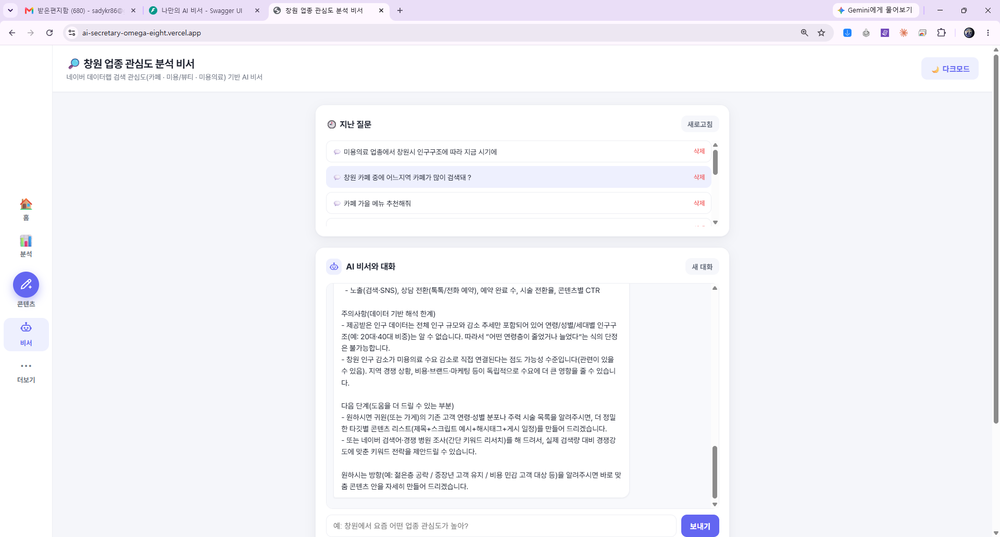 | 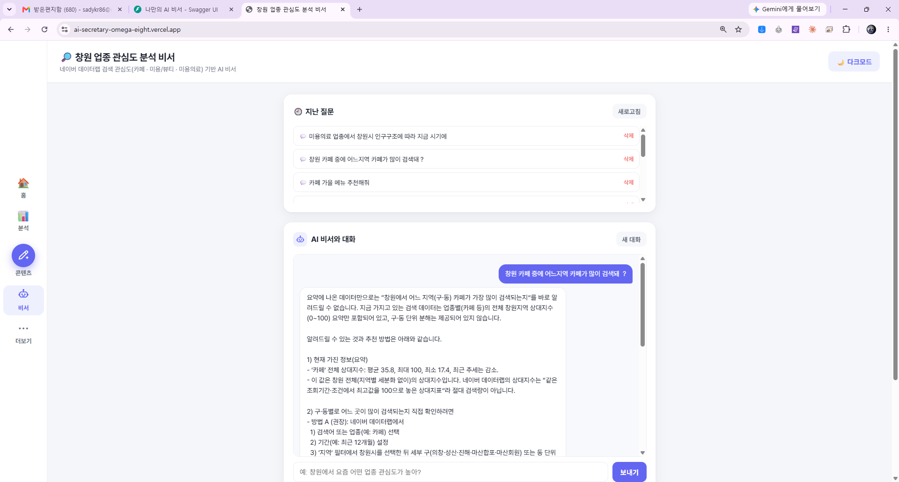 |

### 5. 콘텐츠 추천 (내 상품 기반 롱테일 키워드 + 리뷰 확보)

| 입력 | 결과 앞부분 |
|---|---|
| 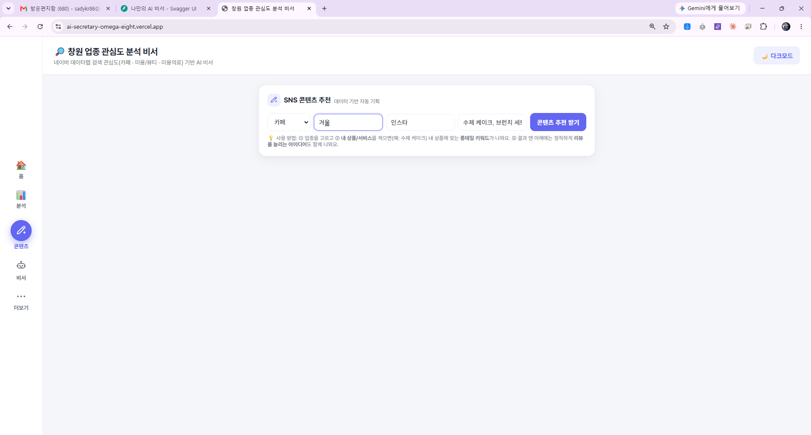 | 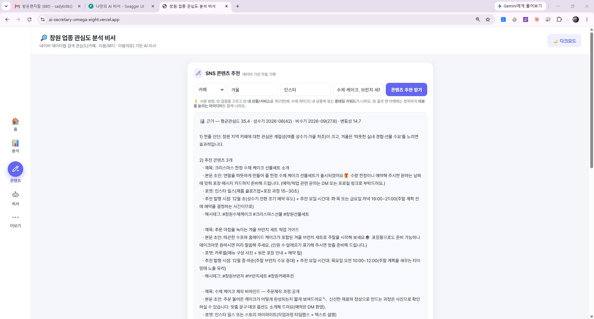 |

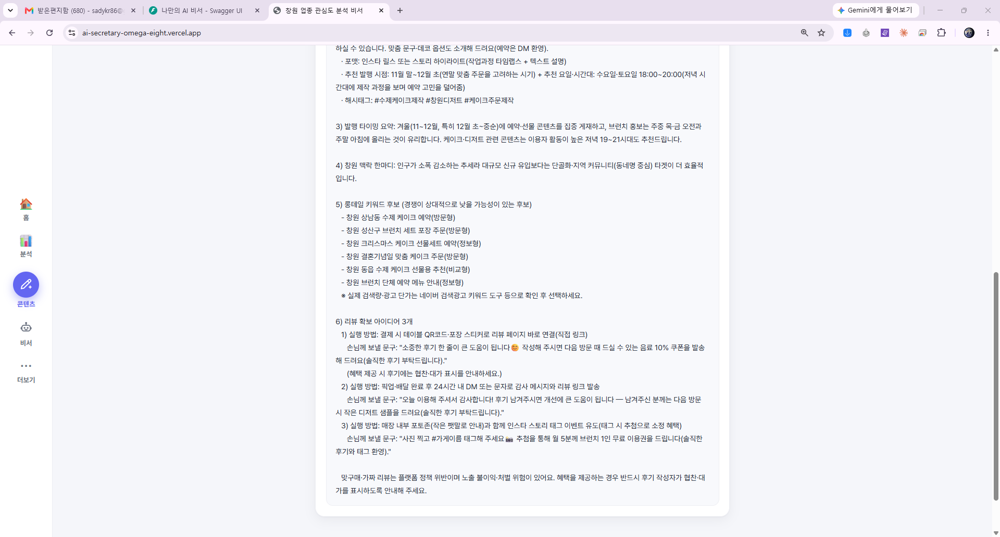

| Swagger 요청 | Swagger 결과 |
|---|---|
| 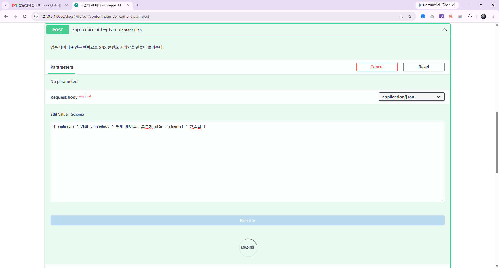 | 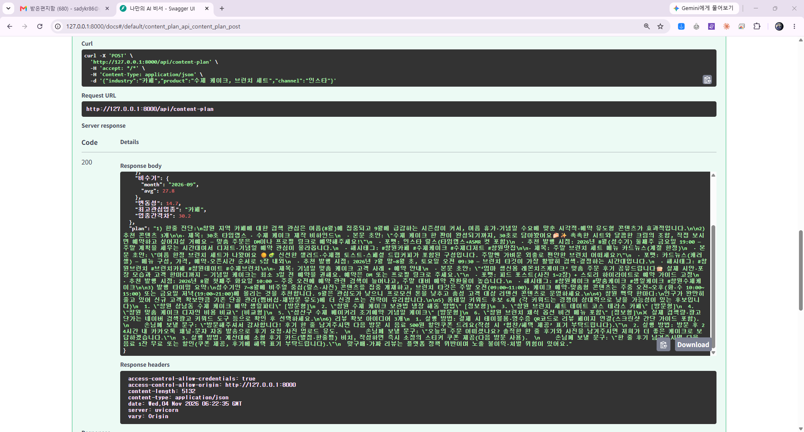 |

---

## 🏆 보너스 과제 — A · B 모두 수행

### 보너스 A. 도구 호출(Function Calling) + 멀티채널(MCP)

#### A-1. GPT 도구 호출 — `POST /api/agent`

GPT가 질문을 보고 **필요한 내부 기능(API)을 "도구"로 스스로 골라 호출**해 실제 데이터를 확인한 뒤 답합니다. 응답의 `tools_used`에 어떤 도구를 썼는지 함께 돌려줍니다.

| 도구 | 어떤 근거로 호출하는가 |
|---|---|
| `get_search_summary` | "요약 / 분위기 / 전반적 흐름"을 물을 때 |
| `get_statistics` | "변동성 / 월별 추이 / 업종 간 격차"가 필요할 때 |
| `get_population_summary` | "창원 인구 / 손님(모집단) 변화" 맥락이 필요할 때 |

**실제 호출 결과**

| 질문 | 호출된 도구 | 스크린샷 |
|---|---|---|
| "업종 중 검색 관심도 변동이 제일 큰 곳은 어디예요?" | `get_statistics` | 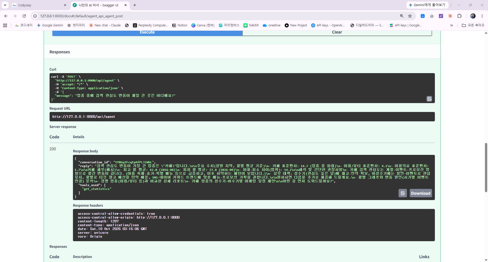 |
| "창원 인구는 줄고 있나요?" | `get_population_summary` | 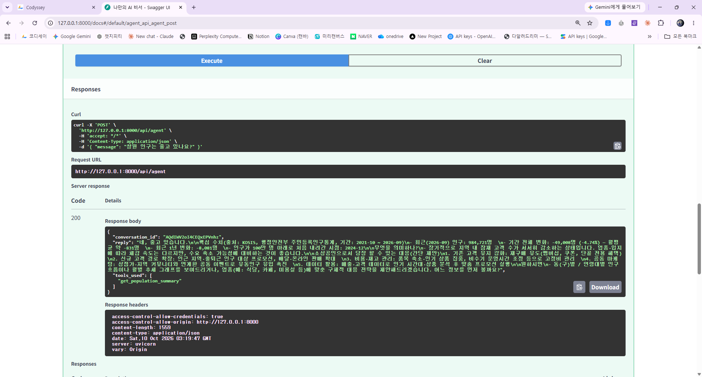 |

질문 내용이 달라지면 GPT가 **서로 다른 도구를 선택**하는 것을 `tools_used`로 확인했습니다.

#### A-2. 멀티채널 — MCP Server (`mcp_server.py`)

같은 기능을 **MCP Server**로도 노출해, 외부 클라이언트인 **Claude Code**에서 호출합니다.
MCP 도구: `get_search_summary` · `get_statistics` · `get_population_summary` · `make_content_plan`

#### 🔁 호출 흐름

```
[사용자 질문]  예) "창원 3업종 검색관심도를 요약해줘"
      │
      ▼
[Claude(외부 채널) / GPT 가 의도 파악 → 도구 선택]
   · 요약/분위기          → get_search_summary
   · 변동성/월별 흐름      → get_statistics
   · 인구/손님 변화        → get_population_summary
   · 콘텐츠/홍보 아이디어   → make_content_plan
      │
      ▼
[MCP Server(mcp_server.py)] ──HTTP──▶ [백엔드(Render)] ──▶ [Firestore 데이터]
      │
      ▼
[도구 결과(JSON)를 받아 자연어로 요약·설명]
```

- MCP 서버는 GPT 키를 직접 쓰지 않고 **이미 배포된 백엔드(Render)를 호출**합니다. (관리해야 할 키가 늘지 않음)

**검증 스크린샷**

| ① 서버 등록 · 연결 확인 (`claude mcp list` → `ai-secretary ✓ Connected`) |
|---|
| 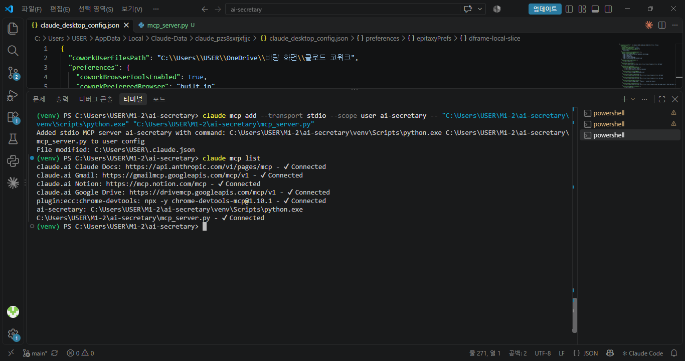 |

| ② Claude Code가 `Called ai-secretary`로 도구 호출 | ③ 도구 결과를 받아 해석 |
|---|---|
| 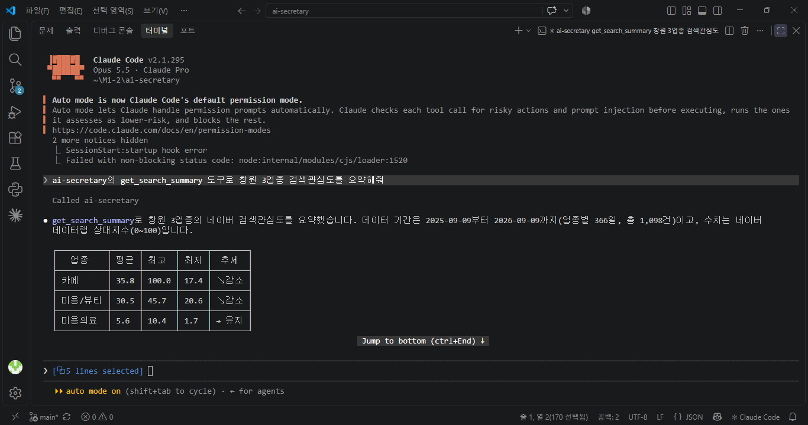 | 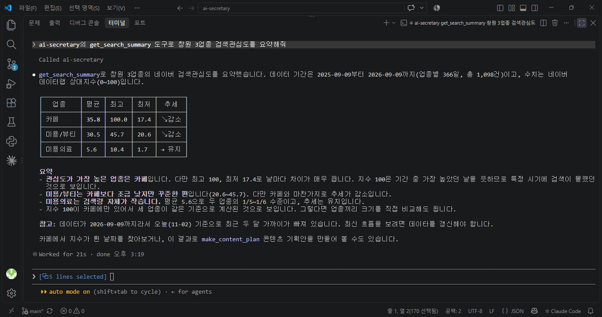 |

### 보너스 B. 인사이트 · UX 고도화

- **추가 지표** — `GET /api/data/statistics` : 변동성, 업종 간 평균 격차, 최고 관심 업종
- **시각화** — 업종별 월별 평균 **추세 그래프**(Chart.js)
- **내보내기** — CSV / JSON / Excel 다운로드
- **다크 모드** — 토글 버튼

| 요약 표 · 추세 그래프 · 내보내기 버튼 | 다크 모드 |
|---|---|
| 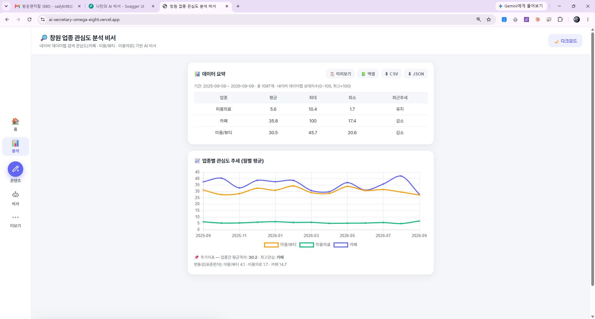 | 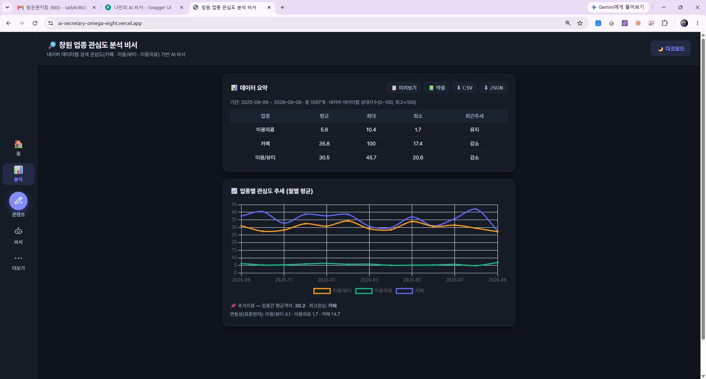 |

---

## 🔌 API 명세

| 메서드 | 경로 | 설명 |
|---|---|---|
| GET | `/` | 서버 상태 확인 |
| GET | `/api/data` | 데이터 목록 조회 |
| POST | `/api/data` | 데이터 추가 |
| PUT | `/api/data/{doc_id}` | 데이터 수정 |
| DELETE | `/api/data/{doc_id}` | 데이터 삭제 |
| GET | `/api/data/summary` | 업종별 요약(기간·개수·평균·추세) |
| GET | `/api/data/statistics` | 추가 통계(변동성·업종 간 격차) — 보너스 B |
| POST | `/api/population/refresh` | KOSIS 인구 최신화(같은 달은 덮어쓰기) |
| GET | `/api/population` | 인구 목록 |
| GET | `/api/population/summary` | 인구 요약(최신값·1년 변화) |
| POST | `/api/chat` | 요약 주입 AI 대화 + 자동 저장 |
| GET | `/api/conversations` | 대화 목록 |
| GET | `/api/conversations/{conv_id}` | 대화 불러오기 |
| POST | `/api/conversations` | 대화 저장 |
| DELETE | `/api/conversations/{conv_id}` | 대화 삭제 |
| POST | `/api/agent` | GPT 도구 호출 에이전트 — 보너스 A |
| POST | `/api/content-plan` | 콘텐츠 기획안 + 롱테일 키워드 + 리뷰 확보 아이디어 |

### 🧠 콘텐츠 추천 프롬프트 설계

- **롱테일 키워드 6개** — "내 상품/서비스"를 입력하면 3단어 이상 검색어 후보를 [정보형/비교형/방문형]으로 나눠 제안합니다. 검색량·광고 단가는 **지어내지 않고**, "네이버 검색광고 키워드 도구 등으로 확인 후 선택"하도록 안내합니다.
- **리뷰 확보 아이디어 3개** — 방법과 고객에게 보낼 문구를 함께 제안합니다.
- **리뷰 안전 규칙** — 맞구매·대행·가짜 리뷰, 긍정 리뷰만 요청, 경쟁사 비방은 제안하지 않고, 협찬·대가 제공 시 표시 의무를 안내합니다.

---

## 💻 로컬 실행 방법

```bash
# 1) 가상환경 활성화
.\venv\Scripts\activate          # Windows
# source venv/bin/activate       # mac / Linux

# 2) 패키지 설치
pip install -r requirements.txt

# 3) 백엔드 실행
uvicorn main:app --reload
#   → http://127.0.0.1:8000/docs (Swagger)

# 4) 프론트엔드
#   index.html 을 브라우저로 열기
```

### MCP 서버(멀티채널) 사용

```bash
# MCP 패키지 설치 (v1 계열)
pip install "mcp<2" requests

# Claude Code 에 서버 등록
claude mcp add --transport stdio --scope user ai-secretary -- "<venv python 경로>" "<mcp_server.py 경로>"

# 연결 확인
claude mcp list        # ai-secretary ✓ Connected
```

---

## 🔑 환경 변수 (`.env`)

| 변수 | 설명 |
|---|---|
| `CODYSSEY_API_KEY` | GPT 호출 키 (코디세이 게이트웨이) |
| `KOSIS_API_KEY` | KOSIS 인구 API 키 |
| `FIREBASE_KEY_PATH` | (로컬) Firebase 서비스계정 키 파일 경로 |
| `FIREBASE_SERVICE_ACCOUNT_JSON` | (배포) Firebase 서비스계정 키 JSON 전체 내용 |

Vercel(프론트)에는 키가 필요 없고, Render(백엔드)의 Environment에 위 값을 넣습니다.

> 🔒 API 키·서비스계정 키 파일은 `.gitignore`로 GitHub에 올라가지 않으며, 코드에는 **환경변수로만** 사용합니다.
> 제출 스크린샷은 키가 보이는 화면을 제외했습니다.

---

## 🧯 트러블슈팅 · 배운 점

- **공공데이터 CSV 폐기 → KOSIS API로 전환** — 공공데이터포털 인구 CSV(약 40만 행)는 연·월 정보가 손상돼 시계열로 쓸 수 없었습니다. KOSIS OpenAPI로 바꿔 **버튼 한 번에 최신 월이 반영**되도록 했습니다.
- **KOSIS는 이름이 아니라 코드로 요청** — 메타정보(getMeta)로 '창원시=48120', '총인구수=T20'을 찾았고, 옛 창원시(48110)와 통합 창원시(48120) 중 후자를 선택했습니다.
- **오류 메시지에 인증키 노출 방지** — 오류 URL에 키가 섞여 출력되는 것을 발견해, 키가 드러나지 않게 오류 처리를 바꿨습니다.
- **같은 달 재수신은 덮어쓰기(upsert)** — 여러 번 새로고침해도 중복이 생기지 않습니다.
- **Claude 데스크톱 GUI는 MCP 서버를 못 읽는 경우가 있어** CLI(`claude mcp add`)로 등록해 해결했습니다.
- **화면 개편 중 HTML 따옴표 하나가 빠져** 미리보기 창이 깨진 일이 있었고, 원인을 찾아 수정·재배포했습니다. (수정 전에 백업본을 두는 습관의 중요성을 배움)
- **무료 서버의 콜드스타트**는 안내 문구로 대응했습니다.

---

## 🔒 보안 고려사항 (학습·데모용 한계와 개선 방향)

이 프로젝트는 **학습·포트폴리오 데모**를 목적으로, 채점·시연 편의를 위해 API를 공개 상태로 두었습니다. 실제 운영 서비스로 전환할 때 보완이 필요한 지점을 함께 정리합니다.

**현재 상태 (의도된 개방)**
- `CORS = allow_origins["*"]` — 모든 출처에서 API 호출 허용 (프론트-백엔드 연동 및 채점 테스트 편의)
- 인증(로그인) 미적용 — 데이터 CRUD를 누구나 호출 가능
- Swagger `/docs` 공개 — API 구조 확인·테스트 가능 (과제 평가 요건)
- 데이터는 네이버 데이터랩·KOSIS **공개 데이터**로, 개인정보 등 민감 정보는 없음

**실제 운영 시 개선 방향**
1. **인증** — 로그인/토큰(JWT, Firebase Auth 등)으로 쓰기(POST·PUT·DELETE) 작업 보호
2. **CORS 제한** — 허용 출처를 내 프론트 주소(Vercel)로 한정
3. **요청 제한(Rate limit)** — GPT 호출 엔드포인트(`/api/chat`·`/api/content-plan`) 남용·비용 폭증 방지
4. **Swagger 접근 제어** — 운영 환경에서는 `/docs`를 비공개로 하거나 인증 뒤에 배치
5. **키 관리 (현재 적용 중)** — API 키·서비스계정 키는 `.env`/환경변수로만 관리하고 `.gitignore`로 저장소 노출 차단

> 요약: 현재의 개방은 '막지 못한 것'이 아니라 **데모·평가를 위한 의도적 설정**이며, 실서비스 전환 시 위 1~4를 적용하면 됩니다.

---

## 📁 폴더 구조

```
ai-secretary/
├─ main.py                # FastAPI 백엔드 (API 전체)
├─ firebase_config.py     # Firestore 연결
├─ kosis_client.py        # KOSIS 인구 API 클라이언트
├─ mcp_server.py          # MCP 서버 (멀티채널 — Claude 연동)
├─ index.html             # 프론트엔드 (대시보드)
├─ requirements.txt
├─ data/                  # 원본 CSV
├─ scripts/               # 데이터 적재 · API 연결 테스트용 스크립트
└─ docs/images/           # 제출 스크린샷
```
