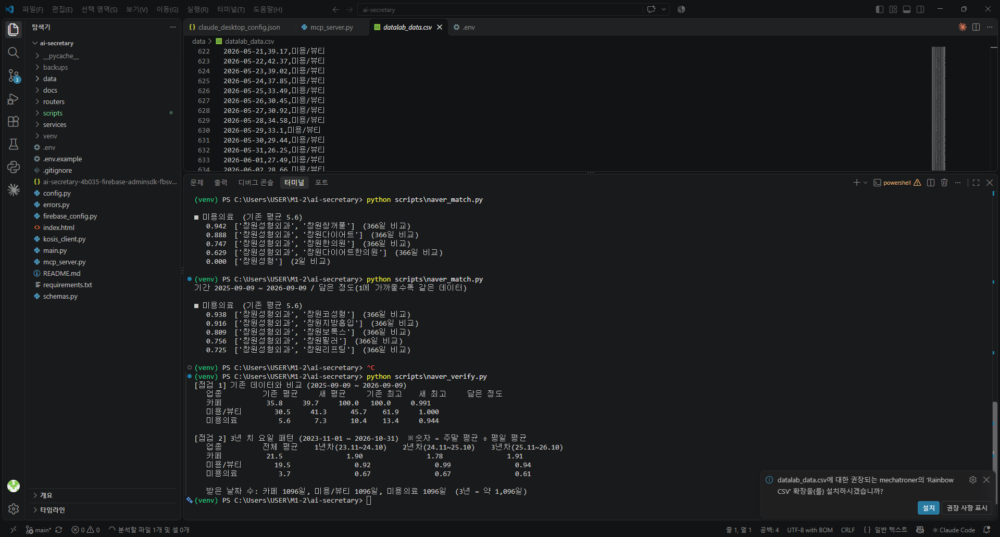
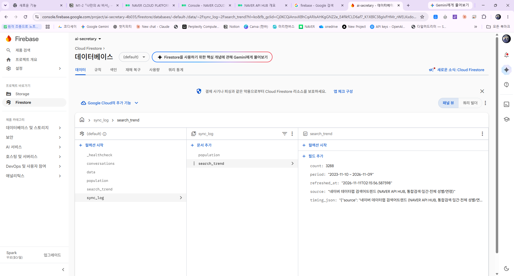
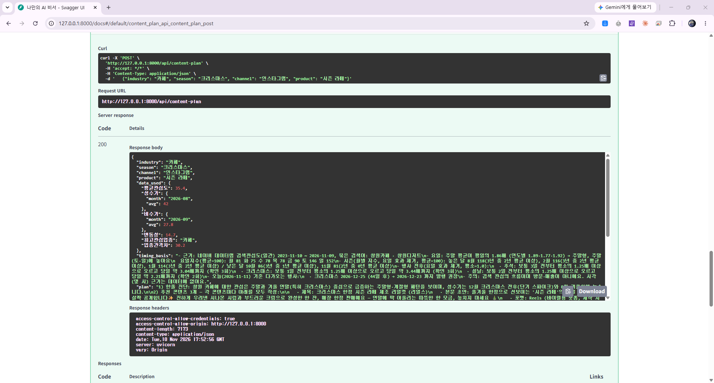
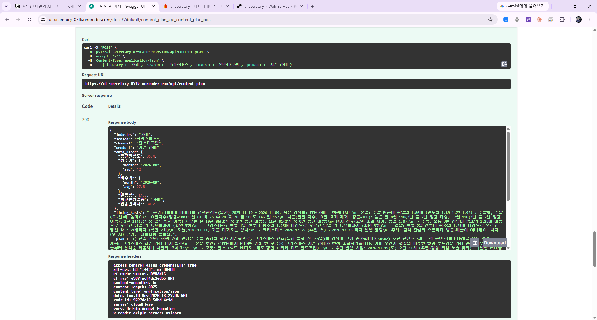
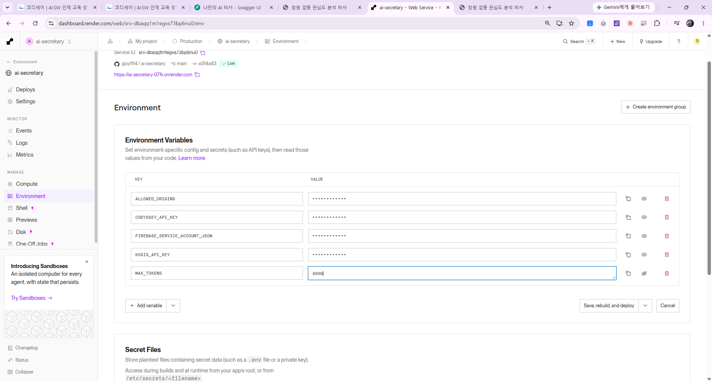
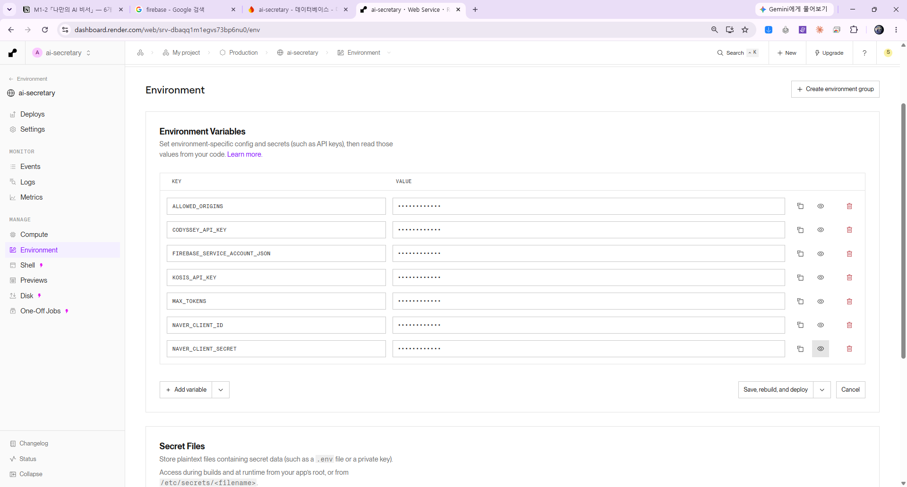

# 🤖 나만의 AI 비서 — 창원 소상공인 데이터 분석 · 콘텐츠 기획 비서

경남 **창원** 소상공인이 "지금 우리 업종 분위기가 어때? 뭘 홍보하면 좋을까?"를 **데이터로 확인하고 바로 실행**할 수 있게 돕는 AI 비서 웹 서비스입니다.

- 네이버 데이터랩 **검색 관심도**(카페 · 미용/뷰티 · 미용의료)와 KOSIS **창원시 인구**를 요약하고
- 그 요약을 **GPT에 주입**해 "왜 그런지"를 대화로 설명하며
- 업종·계절·내 상품을 입력하면 **SNS 콘텐츠 기획안 + 롱테일 키워드 + 리뷰 확보 아이디어**, 그리고 **언제 올리면 좋은지(발행 타이밍 근거)** 까지 만들어 줍니다.

> AI 응용 학습 **M1-2** 개인 과제 — "AI Agent 개발: 나만의 AI 비서"

---

## 🔗 배포 주소

| 구분 | 주소 |
|---|---|
| 프론트엔드 (Vercel) | https://ai-secretary-omega-eight.vercel.app |
| 백엔드 API (Render) | https://ai-secretary-07fk.onrender.com |
| API 문서 (Swagger) | https://ai-secretary-07fk.onrender.com/docs |

> ⏱️ **콜드스타트 안내** — 백엔드는 Render 무료 요금제라 15분 이상 쓰지 않으면 잠듭니다. 처음 접속하면 깨어나는 데 **30초~1분** 걸릴 수 있어요(정상). 두 번째부터는 빠릅니다.
> 대응: ① README와 화면에 안내 문구를 두고, 서버가 자는 중이면 화면에 "30초~1분 뒤 다시 시도해 주세요"라고 알려 줍니다. ② MCP 서버의 호출 대기 시간(timeout)은 90초로 넉넉히 잡았습니다. ③ 서버를 계속 깨워 두는 방법(UptimeRobot 등)은 무료 사용 시간 한도 때문에 이번에는 적용하지 않았습니다.

**접속 확인** — 프론트 주소를 열어 "오늘의 창원 브리핑"이 뜨는지, 또는 Swagger에서 `GET /api/data/summary`를 실행해 `200`이 나오는지 보면 됩니다.

### ✅ 과제 수행 범위

| 구분 | 수행 여부 |
|---|---|
| 필수 과제 (FastAPI · Firestore · GPT · 배포 · 바닐라 프론트 · README) | ✅ 완료 |
| **보너스 A** — 도구 호출(Function Calling) + 멀티채널(**MCP Server**) | ✅ 수행 |
| **보너스 B** — 추가 지표 + 그래프 + 내보내기 + 다크 모드 | ✅ 수행 |
| **추가 기능** — 네이버 API 연동으로 발행 타이밍 근거 제공 | ✅ 수행 |

---

## 📊 데이터

| 구분 | 내용 |
|---|---|
| 기본 데이터(1년) — 검색 관심도 | 네이버 데이터랩 "검색어 트렌드" — 창원 3업종(**카페 · 미용/뷰티 · 미용의료**), 상대지수(0~100, 최고=100), 2025-09-09 ~ 2026-09-09, 업종별 366일 · 총 1,098행 (삭제 시연으로 3행을 지워 현재 **1,095행**) |
| 인구(보강) | KOSIS OpenAPI(원자료: 행정안전부 주민등록인구통계) — 창원시(코드 48120) 총인구수, 월별 최근 60개월 |
| 추가 데이터(3년) — 발행 타이밍 근거 | 네이버 API HUB 데이터랩 — 같은 3업종 일간 상대지수, 최근 3년 · **3,288행**, 별도 `search_trend` 컬렉션 |
| 데이터 구조 | `date`(날짜) / `value`(지수) / `memo`(업종) |

> 검색 관심도는 **상대지수**(절대 검색량이 아님)이고 인구는 **명** 단위라 컬렉션을 분리하고, GPT에는 두 요약을 따로 전달합니다.

---

## ✨ 주요 기능

- **데이터 관리(CRUD)** — 추가 / 조회 / 수정 / 삭제
- **데이터 요약** — 업종별 기간·개수·평균·최고·최저·추세(`/api/data/summary`). 추세는 **최근 N일 평균이 직전 N일 평균보다 5% 넘게 높으면 증가, 5% 넘게 낮으면 감소, 그 사이면 유지**(±5%)이며, N은 `SUMMARY_RECENT_DAYS`(기본 30일) 또는 `?days=N`으로 바꿉니다.
- **인구 연동** — KOSIS 월별 인구를 받아 저장·요약(`/api/population*`)
- **AI 대화** — 데이터 요약을 GPT 시스템 프롬프트에 주입해 답변하고 대화를 자동 저장(`/api/chat`)
- **대화 기록** — 이전 대화 목록 / 불러오기(`/api/conversations`)
- **콘텐츠 추천** — 업종·계절·채널·**내 상품**을 넣으면 기획안 + 롱테일 키워드 6개 + 리뷰 확보 아이디어 3개(`/api/content-plan`)
- **발행 타이밍 근거** — 3년 검색관심도로 요일·월·행사 전후를 계산해 추천의 발행 시점에 근거로 사용(`/api/search-trend/*`)
- **쉬운 대시보드** — 비서 브리핑 말풍선, 업종별 신호등(증가/유지/감소), 하단 5칸 메뉴, **모바일 반응형**(860px 이하 1열, 375px에서 가로 스크롤 없음 확인)
- **요약 재사용** — 요약 계산은 `services/summary.py` 한 곳에 두고 채팅·에이전트·콘텐츠 기획·MCP가 함께 씁니다. 요약은 숫자 몇 줄뿐이라 데이터가 늘어도 길이가 거의 같고, 답변 길이는 `MAX_TOKENS`로 제한합니다.

---

## 🗄️ Firestore 컬렉션 설계 (왜 나눴을까?)

Firestore는 "컬렉션(서랍) 안에 문서(카드)를 넣는" 데이터베이스예요. 데이터의 **성격·단위·사용 방식**이 다르면 서랍을 따로 쓰는 게 안전해서 아래처럼 나눴습니다.

| 컬렉션 | 담는 것 | 문서 ID | 따로 둔 이유 |
|---|---|---|---|
| `data` | 검색 관심도 1일 1건 (`date` / `value` / `memo`) | `업종_날짜` | 단위가 **상대지수(0~100)**라 인구(명)와 섞으면 평균·추세가 의미 없어짐 |
| `population` | 창원시 월별 인구(명) | `YYYY-MM` | 같은 달을 다시 받으면 **덮어쓰기(upsert)**되어 중복이 안 생김 |
| `search_trend` | 네이버 검색관심도 3년 치 (`date` / `value` / `memo`) | `업종_날짜` | 기간(3년)·검색어가 `data`(1년)와 **달라서** 섞으면 기존 숫자가 바뀜 |
| `conversations` | 대화 1건 = 문서 1개 (`messages` 목록 + `created_at` / `updated_at`) | 자동 생성 | 질문·답변은 **계속 늘어나는 기록**이라 분석 데이터와 성격이 다름 |
| `sync_log` | 인구·검색관심도 마지막 갱신 기록(검색관심도는 계산한 타이밍 요약 1개도 보관) | `population`, `search_trend` | 갱신 확인용 · 기획안을 만들 때 수천 개 문서를 다시 읽지 않도록 요약만 저장 |

```json
// data/{자동 id} — 관심도 1건
{ "date": "2026-09-09", "value": 72.5, "memo": "카페" }

// conversations/{id} — 대화 1건
{ "messages": [ { "role": "user", "content": "요즘 어떤 업종 관심도가 높아?" },
                { "role": "assistant", "content": "최근 30일 기준 카페가 가장 높습니다." } ],
  "created_at": "2026-09-09T10:00:00+09:00", "updated_at": "2026-09-09T10:01:12+09:00" }
```

### 💾 대화 저장 정책 · 인덱스 · 보존

| 항목 | 내용 |
|---|---|
| 저장 시점 | GPT 답변을 **받은 뒤** 질문+답변을 한 번에 저장 (답변이 실패하면 저장하지 않음) |
| 새 대화 / 이어서 | `conversation_id`가 없으면 새 문서, 있으면 같은 문서에 이어서 저장 |
| 메시지 형식 | `{"role": "user" 또는 "assistant", "content": "내용"}` 목록 |
| 불러오기 방식 | **(A) 방식** — `GET /api/conversations` 목록에는 `id` / `title`(첫 질문 30자) / `updated_at` / `count`만 있고, 전체 메시지는 `GET /api/conversations/{id}`로 불러옴 |
| 장단점 | 대화 전체가 문서 1개라 불러오기가 **한 번 읽기**로 끝나 단순하지만, 문서 1개의 용량 한도(약 1MB) 때문에 아주 긴 대화에는 맞지 않고 대화가 많아지면 목록이 느려질 수 있음 → 개선: `messages`를 하위 컬렉션으로 분리 |
| 동시 수정 | 같은 대화를 두 곳에서 동시에 이어가면 **마지막 저장이 우선**(개선 방향: 버전 번호를 두는 낙관적 잠금) |
| 인덱스 | `data`는 `memo` 한 칸으로만 걸러 읽어 기본 인덱스로 충분(추가 인덱스 없음) |
| 읽는 양 · 보존 | 목록 조회는 `limit`(기본 100)으로 제한. 검색 관심도는 늘어나는 속도가 느려 현재는 **전부 보존** |

---

## 💉 컨텍스트 주입 — 원리와 장단점

**한 줄 설명** — 일반 ChatGPT는 제 데이터를 모릅니다. 그래서 질문하기 전에 **내 데이터의 "요약 한 장"을 GPT에게 먼저 읽어 주는 것**이 컨텍스트 주입입니다.

**동작 흐름 (`POST /api/chat`)**
1. Firestore의 `data` / `population`에서 **요약을 계산**합니다 (기본 데이터 1년 치 1,095개 전체가 아니라 기간·개수·평균·최대·최소·추세만).
2. 요약을 문장으로 바꿔 **시스템 프롬프트**(GPT에게 주는 역할·배경 설명)에 끼워 넣습니다. "데이터에 없는 내용은 모른다고 하세요"라는 지시도 함께 넣습니다.
3. 이전 대화 + 새 질문과 함께 GPT를 호출하고, 답변을 `conversations`에 저장합니다.

| 구분 | 내용 |
|---|---|
| 👍 장점 | ① **내 데이터를 근거로** 답함 ② **요약만** 넣어 토큰·비용 절약 ③ "모르면 모른다"는 지시로 **지어내기 감소** ④ 별도 학습·벡터DB 없이 **구현이 단순**하고 데이터가 바뀌면 다음 질문부터 자동 반영 |
| 👎 단점 | ① **요약에 없는 세부**(특정 날짜 값 등)는 답하기 어려움 ② 매 요청마다 요약+대화 이력을 보내 **대화가 길어지면 토큰 비용 증가** ③ 데이터가 **외부 GPT 서버로 전달**됨 ④ 요약이 커지면 길이 제한 필요 |
| 🔧 대응 | ① 세부 질문은 `/api/agent`(도구 호출)가 필요할 때 직접 조회 ② `MAX_TOKENS`로 답변 길이 상한 ③ **공개 데이터만** 사용하고 개인정보는 넣지 않음 ④ 업종이 늘면 핵심 지표만 요약 |

---

## 🛡️ 입력값 검증 (Pydantic)

**Pydantic**은 서버가 받은 값이 약속한 모양인지 **문 앞에서 먼저 검사**해 주는 도구입니다. 잘못된 값은 저장되기 전에 걸러져요.

| 항목 | 규칙 | 틀리면 |
|---|---|---|
| `date` | `YYYY-MM-DD` 형식 + **실제로 있는 날짜** (2026-13-45는 거절) | 422 + "날짜: 형식이 맞지 않아요 (예: 2026-09-09)" |
| `value` | 숫자, **0 이상 100 이하** (상대지수) | 422 + "값: 100 이하여야 해요" 등 |
| `memo` (업종) | 1~30자, **한글·영문·숫자·공백·`/`·`·`·`_`·`-`만 허용**, 첫 글자는 글자나 숫자 | 422 + "업종: 한글·영문·숫자·공백·/ 만 쓸 수 있어요" |
| `message` (채팅 질문) | 1~1,000자 | 422 + "메시지: 너무 길어요" 등 |
| `industry` · `season` · `channel` · `product` | 각각 최대 30자, 상품(`product`)은 최대 100자 | 422 + "너무 길어요" 등 |
| `messages` (대화 저장) | 최대 200개 | 422 + "항목이 너무 많아요" |

- **이중 검증** — 화면에서 빈칸을 먼저 확인하고 서버가 한 번 더 검사하며, 서버의 한글 안내 문구는 화면에 그대로 표시됩니다.
- **XSS 방지** — XSS는 "누군가 심어 둔 글자 속 코드가 다른 사람의 브라우저에서 실행되는 공격"이에요. 서버가 `<` `>` 따옴표와 엑셀 수식 시작 글자(`=` `+` `-` `@`)를 먼저 막고, 화면도 HTML에 넣기 전에 특수문자를 안전한 글자로 바꿉니다(`esc()`). **2중 방어**입니다.
- **서버 기록(로깅)** — 검증에 걸린 요청은 "어느 주소에서 어떤 칸이 왜 걸렸는지"만 Render Logs에 남기고, 입력 내용은 개인정보·키 노출을 막기 위해 남기지 않습니다.
- **예외 처리** — 없는 데이터는 404, 외부 API(KOSIS·네이버) 실패는 502, GPT 호출 실패는 원인을 담아 500으로 알려 줍니다.

---

## 🧱 프로젝트 구성 · 폴더 구조

```
ai-secretary/
├─ main.py             # 앱 시작점 — CORS·오류 안내 설정 후 routers/를 붙이기만 함
├─ config.py           # 환경변수 설정 (CORS·추세 기간·토큰 상한·캐시 시간)
├─ config.js           # 프론트엔드 설정 — 백엔드 주소(배포·로컬)를 이 파일에서만 관리
├─ schemas.py          # 요청 모델 (입력 검증, Pydantic)
├─ errors.py           # 입력 오류를 한글로 안내 + 서버 내부 오류는 로그에만 남기고 화면엔 안내 문구만
├─ routers/            # API 경로: data · population · chat · agent · conversations · content_plan · search_trend
├─ services/           # 계산·외부 연동: summary · population · llm · agent_tools · search_trend · timing · cache
├─ firebase_config.py  # Firestore 연결 (DB 연결은 이 한 곳에서만)
├─ kosis_client.py     # KOSIS 인구 API 호출
├─ naver_client.py     # 네이버 데이터랩 검색어트렌드 API 호출
├─ mcp_server.py       # MCP 서버 (Claude Code용 출입구, 백엔드를 HTTP로 호출만 함)
├─ index.html          # 프론트엔드 (바닐라 HTML/CSS/JS)
├─ requirements.txt · .env.example   # 패키지 목록 · 환경변수 견본(값은 비어 있음)
├─ data/ · scripts/    # 원본 CSV · 데이터 적재·API 연결 확인용 스크립트
└─ docs/images/        # 제출 스크린샷
```

- **왜 나눴나** — 처음엔 `main.py` 한 파일(약 760줄)이었지만, 기능이 늘면서 **API 경로(routers)**와 **계산 로직(services)**을 분리했습니다. 요약 계산은 채팅·에이전트·콘텐츠 기획이 함께 쓰기 때문에 `services/`에 한 번만 둡니다.
- **동작은 그대로** — API 주소·요청/응답 형식은 바뀌지 않았습니다(실행: `uvicorn main:app`).

---

## 🔌 API 명세

| 메서드 | 경로 | 설명 |
|---|---|---|
| GET | `/` | 서버 상태 확인 |
| GET · POST | `/api/data` | 데이터 목록 조회(**날짜 최신순**, `?memo=업종`·`?limit=1~2000`) · 추가 |
| PUT · DELETE | `/api/data/{doc_id}` | 데이터 수정 · 삭제 |
| GET | `/api/data/summary` | 업종별 요약(기간·개수·평균·추세). 선택 쿼리 `?days=N`(1~365, 기본 30), 응답의 `recent_days`·`generated_at`로 비교 기간과 생성 시각 확인 |
| GET | `/api/data/statistics` | 추가 통계(변동성·업종 간 격차) — 보너스 B |
| POST | `/api/population/refresh` | KOSIS 인구 최신화(같은 달은 덮어쓰기) |
| GET | `/api/population` · `/api/population/summary` | 인구 목록 · 요약(최신값·1년 변화) |
| POST | `/api/chat` | 요약 주입 AI 대화 + 자동 저장 |
| GET · POST | `/api/conversations` | 대화 목록(**최신순, 기본 최근 50개**, `?limit=1~200`) · 저장 |
| GET · DELETE | `/api/conversations/{conv_id}` | 대화 불러오기 · 삭제 |
| POST | `/api/agent` | GPT 도구 호출 에이전트 — 보너스 A |
| POST | `/api/content-plan` | 콘텐츠 기획안 + 롱테일 키워드 + 리뷰 확보 아이디어 + 발행 타이밍 근거 |
| POST | `/api/search-trend/refresh` | 네이버에서 최근 3년 검색관심도를 받아 `search_trend`에 저장(전체 기간 통째 갱신) + 타이밍 요약 계산 |
| GET | `/api/search-trend/summary` | 발행 타이밍 요약(업종별 요일·월별 지수·행사 전후) |

**요청 · 응답 예시**

`GET /api/data/summary?days=14` (`days`는 선택, 비우면 30)
```json
{ "period": "2025-09-09 ~ 2026-09-09", "count": 1095, "recent_days": 14,
  "generated_at": "2026-11-06T13:58:31+09:00",
  "unit": "네이버 데이터랩 상대지수(0~100, 최고=100)",
  "by_industry": { "카페": { "count": 366, "average": 35.8, "max": 100, "min": 17.4, "trend": "감소" } } }
```

`POST /api/data`
```json
// 요청
{ "date": "2026-09-09", "value": 35.8, "memo": "카페" }
// 성공 (200)
{ "message": "저장했어요", "id": "문서ID" }
// 값이 범위를 벗어났을 때 (422)
{ "detail": "입력값을 확인해 주세요 → 값: 100 이하여야 해요", "errors": ["값: 100 이하여야 해요"] }
```

---

## 🕒 추가 기능 — 발행 타이밍 근거 (네이버 데이터랩 API 연동)

**역할 분담** — 검색관심도 시계열은 "무엇을 올릴지"가 아니라 **"언제 올릴지"**를 알려 줍니다. 메뉴·주제는 사용자가 입력한 상품과 AI가 정하고, 이 기능은 올리는 **요일·시기·행사 전 발행일**에 데이터 근거를 붙입니다. 기존 데이터(`data`)와 기존 숫자는 건드리지 않고, 3년치를 **별도 컬렉션**에 더했습니다.

```
네이버 API HUB (데이터랩 검색어트렌드, 최근 3년·일간)
   │  POST /api/search-trend/refresh
   ▼
Firestore  search_trend (3업종 × 1,096일)  +  sync_log/search_trend (계산한 타이밍 요약 1개)
   │  POST /api/content-plan 이 요약을 프롬프트에 주입
   ▼
기획안: "주말이 평일의 1.86배", "크리스마스는 12/23까지 발행" 처럼 근거가 붙은 발행 시점
```

**묶은 검색어** — 3업종을 한 번의 요청에 담아 같은 잣대(상대지수)로 받습니다.

| 업종 | 검색어 | 기존 1년 데이터와 닮은 정도 |
|---|---|---|
| 카페 | 창원카페, 창원디저트 | 0.991 |
| 미용/뷰티 | 창원미용실, 창원네일, 창원속눈썹 | 1.000 (일치) |
| 미용의료 | 창원성형외과 | 0.944 |

기존 1년 데이터를 만들 때 쓴 검색어는 기록이 남아 있지 않아서, 후보 검색어로 같은 기간(2025-09-09~2026-09-09)을 받아 **그래프 모양이 가장 닮은 검색어**로 정했습니다(`scripts/naver_verify.py`). 그래서 미용의료는 "성형외과 검색 기준"입니다.

**계산 내용** (`services/timing.py`) — **요일**(주말 평균 ÷ 평일 평균, 연도별로 반복되는지 확인) · **월별 지수**(요일 효과를 걷어낸 뒤 계산, 25일 미만인 달 제외) · **행사 전후**(설날·추석·크리스마스 등이 평소의 1.25배 이상으로 오르기 시작하는 시점, 다른 행사와 겹치는 해는 제외) · **다가오는 행사**(오늘 기준 75일 안의 행사와 "언제까지 발행하면 좋은지").

**3년 검증 결과** (2023-11-01 ~ 2026-10-31) — 주말 평균 ÷ 평일 평균

| 업종 | 1년차 | 2년차 | 3년차 | 해석 |
|---|---|---|---|---|
| 카페 | 1.90 | 1.78 | 1.91 | 해마다 주말이 약 1.8~1.9배 |
| 미용/뷰티 | 0.92 | 0.99 | 0.94 | 요일 차이가 거의 없음 |
| 미용의료 | 0.67 | 0.67 | 0.61 | 해마다 평일이 더 높음 |

1년 데이터로는 10월이 카페의 가장 높은 달이었지만 3년으로 보니 낮은 달이었습니다(2025년 추석 연휴 효과로 추정). 1년 치만으로는 계절 패턴과 우연을 구분하기 어려워 3년을 사용합니다.

**한계와 안전장치**
- 값은 **상대지수**(조회 기간 안의 최고=100)라 기간을 바꾸면 모든 숫자가 다시 계산됩니다 → 갱신은 항상 **전체 기간을 통째로** 받습니다. 업종 간 크기 비교는 어떤 검색어를 묶었느냐에 따라 달라집니다.
- 검색 관심은 방문·매출이 아니라 **관심의 흐름**이고, **시각(몇 시) 정보는 없습니다.** 추천에 나오는 시각(예: 오전 11시)은 데이터가 아니라 AI의 일반적인 권장이며, 근거에는 요일·날짜만 쓰입니다.
- 행사 달력은 코드에 직접 적은 날짜입니다(음력 명절은 2027년까지).
- 타이밍 요약은 갱신할 때 한 번 계산해 **문서 1개**로 보관하므로(Firestore 무료 읽기 한도 보호), 근거가 없거나 읽기 오류가 나도 기획안은 **기존 방식 그대로** 만들어집니다.

**확인 화면** — 검증 결과, Firestore 저장, 콘텐츠 추천 결과, 배포 서버 동작

| 유사도 · 3년 요일 패턴 점검 | Firestore `sync_log` (3,288건 · 기간) |
|---|---|
|  |  |

| 로컬 콘텐츠 추천 (`timing_basis` 포함) | 배포 서버 콘텐츠 추천 |
|---|---|
|  |  |

> 값은 '기간 내 최고=100'인 **상대지수**로, 방문·매출이 아니라 관심의 흐름입니다. 네이버 비밀키는 `.env`/환경변수로만 관리하며 화면에는 나타나지 않습니다.

---

## 🏆 보너스 과제 — A · B 모두 수행

### 보너스 A. 도구 호출(Function Calling) + 멀티채널(MCP)

**A-1. GPT 도구 호출 — `POST /api/agent`** — GPT가 질문을 보고 **필요한 내부 기능(API)을 "도구"로 스스로 골라 호출**해 실제 데이터를 확인한 뒤 답합니다. 응답의 `tools_used`에 어떤 도구를 썼는지 함께 돌려줍니다.

| 도구 | 어떤 근거로 호출하는가 |
|---|---|
| `get_search_summary` | "요약 / 분위기 / 전반적 흐름"을 물을 때 |
| `get_statistics` | "변동성 / 월별 추이 / 업종 간 격차"가 필요할 때 |
| `get_population_summary` | "창원 인구 / 손님(모집단) 변화" 맥락이 필요할 때 |

| 질문 | 호출된 도구 | 스크린샷 |
|---|---|---|
| "업종 중 검색 관심도 변동이 제일 큰 곳은 어디예요?" | `get_statistics` |  |
| "창원 인구는 줄고 있나요?" | `get_population_summary` |  |

질문 내용이 달라지면 GPT가 **서로 다른 도구를 선택**하는 것을 `tools_used`로 확인했습니다.

**A-2. 멀티채널 — MCP Server (`mcp_server.py`)** — 같은 기능을 **MCP Server**로도 노출해 외부 클라이언트인 **Claude Code**에서 호출합니다. MCP 도구: `get_search_summary` · `get_statistics` · `get_population_summary` · `make_content_plan`

```
[사용자 질문] → [Claude(외부 채널) / GPT 가 의도 파악 → 도구 선택]
   · 요약/분위기 → get_search_summary      · 변동성/월별 흐름 → get_statistics
   · 인구/손님 변화 → get_population_summary · 콘텐츠/홍보 아이디어 → make_content_plan
      ▼
[MCP Server(mcp_server.py)] ──HTTP──▶ [백엔드(Render)] ──▶ [Firestore]
      ▼
[도구 결과(JSON)를 받아 자연어로 요약·설명]
```

MCP 서버는 GPT 키를 직접 쓰지 않고 **이미 배포된 백엔드(Render)를 호출**합니다(관리해야 할 키가 늘지 않음).

| ① 서버 등록 · 연결 확인 (`ai-secretary ✓ Connected`) |
|---|
|  |

| ② `Called ai-secretary`로 도구 호출 | ③ 도구 결과를 받아 해석 |
|---|---|
|  |  |

### 보너스 B. 인사이트 · UX 고도화

- **추가 지표** — `GET /api/data/statistics` : 변동성, 업종 간 평균 격차, 최고 관심 업종
- **시각화** · **내보내기** · **다크 모드** — 업종별 월별 평균 추세 그래프(Chart.js), CSV / JSON / Excel 다운로드, 토글 버튼

| 요약 표 · 추세 그래프 · 내보내기 버튼 | 다크 모드 |
|---|---|
|  |  |

---

## 🖼️ 제출 스크린샷

### 1. 배포 URL 접속 (프론트 / 백엔드 / Swagger)

| 백엔드 Swagger(`/docs`) | 백엔드 데이터 요약 실행 |
|---|---|
|  |  |

| Vercel 배포 성공 | 배포된 프론트 홈 |
|---|---|
|  |  |

### 2. 데이터 요약이 보이는 채팅 화면 (질문 + 답변)

데이터 요약이 GPT에 주입된 상태에서 질문하면, 요약 수치를 근거로 답합니다.

| 질문 전 | 로딩 표시("생각 중…") |
|---|---|
|  |  |

| 질문 + 답변 | 답변 이어서 |
|---|---|
|  |  |

### 3. 데이터 관리 화면 (삭제 동작 확인)

삭제 전에는 맨 위 날짜가 `2025-09-10`, 삭제 후에는 `2025-09-12`로 바뀌어 행이 지워진 것을 확인할 수 있습니다.

| 삭제 전 | 삭제 후 |
|---|---|
|  |  |

### 4. 대화 기록 화면 (불러오기 동작)

| 지난 대화 선택 | 불러온 결과 |
|---|---|
|  |  |

### 5. 콘텐츠 추천 (내 상품 기반 롱테일 키워드 + 리뷰 확보)

| 입력 | 결과 앞부분 |
|---|---|
|  |  |


| Swagger 요청 | Swagger 결과 |
|---|---|
|  |  |

> 발행 타이밍 근거(네이버 API 연동) 화면은 위 **추가 기능** 섹션에 있습니다.

---

## 💻 로컬 실행 방법

> 사전 준비: **Python 3.10 이상**과 가상환경(`venv`)을 사용합니다.

```bash
# 0) .env.example 을 복사해 .env 로 이름을 바꾸고 값을 채우기
# 1) 가상환경 활성화
.\venv\Scripts\activate          # Windows
# source venv/bin/activate       # mac / Linux
# 2) 패키지 설치
pip install -r requirements.txt
# 3) 백엔드 실행  →  http://127.0.0.1:8000/docs (Swagger)
uvicorn main:app --reload
# 4) 프론트엔드: index.html 을 브라우저로 열기 (localhost로 열면 http://localhost:8000 서버를 자동 사용, 설정은 config.js)
```

**MCP 서버(멀티채널) 사용**

```bash
pip install "mcp<2" requests                      # MCP 패키지 설치 (v1 계열)
claude mcp add --transport stdio --scope user ai-secretary -- "<venv python 경로>" "<mcp_server.py 경로>"
claude mcp list                                   # ai-secretary ✓ Connected
```

---

## 🔑 환경 변수 (`.env`)

| 변수 | 필수 | 설명 |
|---|---|---|
| `CODYSSEY_API_KEY` | ✅ | GPT 호출 키 (코디세이 OpenAI 호환 게이트웨이, 지시서의 `OPENAI_API_KEY`에 해당) |
| `KOSIS_API_KEY` | ✅ (인구 갱신 시) | KOSIS 인구 API 키 |
| `NAVER_CLIENT_ID` · `NAVER_CLIENT_SECRET` | ✅ (검색관심도 갱신 시) | 네이버 API HUB 데이터랩 키 — **비밀키**라 `.env`(로컬)와 Render에만 |
| `FIREBASE_KEY_PATH` | ✅ (로컬) | Firebase 서비스계정 키 **파일 경로** |
| `FIREBASE_SERVICE_ACCOUNT_JSON` | ✅ (배포) | Firebase 서비스계정 키 **JSON 전체 내용** |
| `ALLOWED_ORIGINS` | 선택 | CORS 허용 주소(쉼표로 여러 개). 비우면 `*`(모두 허용). **배포(Render)에는 Vercel 주소만 넣어 제한**했습니다 |
| `SUMMARY_RECENT_DAYS` | 선택 | 추세 비교 기간 (기본 `30`) |
| `CACHE_TTL_SECONDS` | 선택 | 요약·통계 계산 결과를 기억해 두는 시간(초, 기본 `60`, `0`이면 끔). 데이터를 추가·수정·삭제하면 바로 비워져요 |
| `MAX_TOKENS` | 선택 | GPT 답변 길이 상한 (기본 `6000`, `0`이면 제한 없음). `gpt-5-mini`는 답하기 전 "생각"에도 토큰을 써서 너무 작게 잡으면 빈 답변이 옵니다 |

- **프론트→백엔드 주소** — 프론트는 빌드 과정이 없는 정적 HTML이라 환경변수 대신 **`config.js`의 `API_URL`(배포) / `LOCAL_API_URL`(로컬)** 로 관리합니다. 주소가 바뀌면 `index.html`이 아니라 `config.js`만 고치면 됩니다. `localhost`로 열면 로컬 서버를, 주소창에 `?api=https://…`를 붙이면 그 주소를 우선 사용합니다. Vercel(프론트)에는 키가 필요 없습니다.
- **견본 파일** — `.env.example`을 복사해 `.env`로 쓰세요(`.env`는 GitHub에 올라가지 않습니다).

**Render 환경변수 설정 순서** — ① Render 대시보드 → 서비스(`ai-secretary`) → **Environment** → ② **Add variable**로 `CODYSSEY_API_KEY`, `FIREBASE_SERVICE_ACCOUNT_JSON`, `KOSIS_API_KEY`, `NAVER_CLIENT_ID`, `NAVER_CLIENT_SECRET`, `ALLOWED_ORIGINS`(Vercel 주소), `MAX_TOKENS`(`6000`) 입력 → ③ **Save, rebuild, and deploy** 후 Deploys 탭에서 `Live` 확인

| Render 환경변수 (값은 가려짐, `MAX_TOKENS=6000`) | 네이버 키 추가 후 (이름만, 값 가림) |
|---|---|
|  |  |

> 🔒 API 키·서비스계정 키 파일은 `.gitignore`로 GitHub에 올라가지 않으며 코드에는 **환경변수로만** 사용합니다. 제출 스크린샷은 키가 보이는 화면을 제외했습니다.

---

## 🔒 보안 고려사항 (학습·데모용 한계와 개선 방향)

이 프로젝트는 **학습·포트폴리오 데모**가 목적이라, 채점·시연 편의를 위해 API를 공개 상태로 두었습니다.

**현재 상태 (의도된 개방)** — `CORS`는 코드 기본값이 `*`지만 **배포에는 `ALLOWED_ORIGINS`로 Vercel 주소만 허용**합니다 · 인증(로그인) 미적용 · Swagger `/docs` 공개 · 데이터는 네이버 데이터랩·KOSIS **공개 데이터**라 민감 정보 없음.

**실제 운영 시 개선 방향** — ① 로그인/토큰(JWT, Firebase Auth 등)으로 쓰기(POST·PUT·DELETE) 보호 ② GPT 호출 엔드포인트(`/api/chat`·`/api/content-plan`)에 요청 제한(rate limit) ③ 운영 환경에서는 `/docs`를 비공개로 하거나 인증 뒤에 배치 ④ 키는 지금처럼 환경변수로만 관리.

> 요약: 현재의 개방은 '막지 못한 것'이 아니라 **데모·평가를 위한 의도적 설정**이며, CORS 제한과 키 관리는 이미 적용되어 있습니다.

---

## 🔧 동료평가 반영 (수정 · 보완)

동료평가에서 받은 보완점을 코드와 대조해 모두 확인했고, 아래처럼 고쳤습니다.

| 지적 사항 | 원인(코드 확인) | 수정 내용 |
|---|---|---|
| 정렬 기준이 없어 새 데이터가 목록에 바로 안 보일 수 있음 | `GET /api/data`가 정렬 없이 `limit`만 적용 | **날짜 내림차순**으로 정렬해 최신 데이터가 맨 위에 옵니다. 업종 필터(`?memo=`)는 Firestore 복합 색인 없이 동작하도록 가져온 뒤 정렬합니다. `limit`은 1~2000으로 제한 |
| 추세가 날짜 범위가 아니라 "최근 N개" 기준 | `values[-days:]`처럼 개수로 자름 | 가장 최근 날짜에서 N일 전까지를 **실제 날짜 범위**로 나눠 비교합니다(날짜가 비어 있어도 정확). 응답에 비교한 기간(`trend_basis`)을 함께 표시 |
| 서버 내부 오류 메시지 노출 | `예외이름: 내용`, `.env` 키 이름, 외부 API 응답 본문이 화면에 그대로 전달 | 자세한 원인은 **서버 로그에만** 남기고(`errors.server_error`) 화면에는 안내 문구만 보냅니다. 예상 못 한 오류도 마지막 안전망(`unhandled_error_handler`)이 같은 방식으로 처리 |
| 프론트엔드 API 주소 하드코딩 | `index.html`에 Render 주소가 박혀 있음 | **`config.js`** 로 분리. localhost로 열면 로컬 서버를 자동 사용하고, `?api=`로 임시 변경도 가능 |
| 데이터가 늘면 전체 조회로 비용·성능 문제 | 질문마다 `data` 컬렉션 전체 + 인구 전체 조회, 대화 목록도 전체 조회 | 요약·통계·인구 요약 결과를 **60초 캐시**(데이터 변경 시 즉시 비움). 대화 목록은 **최신순 최근 50개만** Firestore에서 조회 |

**한계와 향후 개선** — 캐시는 서버 메모리에 저장하므로 서버가 다시 시작되면 비워지고, 서버를 여러 대로 늘리면 서버마다 따로 기억합니다(이 과제는 서버 1대 기준). 데이터가 수만 건 이상으로 커지면 요약 결과를 Firestore에 미리 계산해 저장하거나, 날짜 범위 조건으로 필요한 구간만 읽는 방식으로 바꾸는 것이 다음 단계입니다. 프론트의 그래프·내보내기는 전체 데이터를 한 번에 불러오므로, 데이터가 커지면 페이지 단위 조회가 필요합니다.

---

## 🧯 트러블슈팅 · 배운 점

- **공공데이터 CSV 폐기 → KOSIS API로 전환** — 인구 CSV(약 40만 행)는 연·월 정보가 손상돼 시계열로 쓸 수 없었습니다. KOSIS OpenAPI로 바꿔 **버튼 한 번에 최신 월이 반영**되도록 했습니다.
- **KOSIS는 이름이 아니라 코드로 요청** — 메타정보(getMeta)로 '창원시=48120', '총인구수=T20'을 찾았고, 옛 창원시(48110)와 통합 창원시(48120) 중 후자를 선택했습니다.
- **오류 메시지에 인증키 노출 방지** — 오류 URL에 키가 섞여 출력되는 것을 발견해, 키가 드러나지 않게 오류 처리를 바꿨습니다.
- **같은 달 재수신은 덮어쓰기(upsert)** — 여러 번 새로고침해도 중복이 생기지 않습니다.
- **Claude 데스크톱 GUI는 MCP 서버를 못 읽는 경우가 있어** CLI(`claude mcp add`)로 등록해 해결했습니다.
- **화면 개편 중 HTML 따옴표 하나가 빠져** 미리보기가 깨진 일이 있었고, 원인을 찾아 수정·재배포했습니다(수정 전에 백업본을 두는 습관의 중요성).
- **무료 서버의 콜드스타트**는 안내 문구로 대응했습니다.
- **`MAX_TOKENS`를 1,500으로 정했다가 답변이 비어 "오류: 알 수 없음"이 떴습니다.** `gpt-5-mini`는 답하기 전 "생각"에도 토큰을 쓰기 때문에 상한이 작으면 생각만 하다 끝납니다. 6,000으로 올려 해결했고, 상한은 "생각 + 답변"의 합이라는 점을 배웠어요.
- **상대지수는 기간·검색어가 바뀌면 숫자가 달라집니다(네이버 연동).** 기존 1년 데이터의 검색어 기록이 없어서 후보 검색어를 기존 그래프와 대조해 가장 닮은 묶음을 찾았고, 갱신은 항상 전체 기간을 통째로 받도록 했습니다. 기존 데이터는 그대로 두고 새 컬렉션에 더해 서로 숫자가 흔들리지 않게 했습니다.
